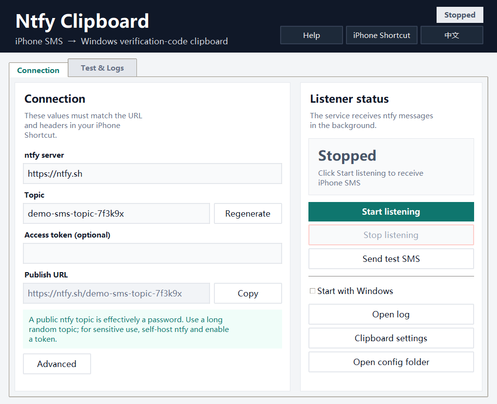

# Ntfy Clipboard

**iPhone SMS → ntfy → Windows verification-code clipboard**

[中文说明](README.zh-CN.md)

> **Attribution:** This is an unofficial secondary development built on [ntfy](https://github.com/binwiederhier/ntfy). It also uses an iPhone Shortcut adapted from the original created and shared by **谢週五**. See [Credits and attribution](CREDITS.md).

Ntfy Clipboard is a small Windows desktop app that receives SMS forwarded from an iPhone through [ntfy](https://ntfy.sh/) and puts the verification code into the Windows clipboard.

The clipboard sequence is intentional:

1. The **full SMS** is copied first.
2. After a short delay, the **verification code** is copied.

So the current clipboard contains the code, while `Win+V` clipboard history contains the code as the latest item and the full SMS as the previous item.



## Features

- Desktop GUI — no command line required.
- Background tray icon on the Windows notification area.
- Right-click tray menu: **Open manager**, **Start listening**, **Stop listening**, **Exit**.
- Closing the window hides it to the tray instead of stopping the listener.
- Optional **Start with Windows** mode; the app starts minimized in the tray.
- Chinese / English UI switch in the top-right corner.
- ntfy JSON-stream subscription with automatic reconnect and message de-duplication.
- Windows clipboard history friendly: full SMS first, verification code last.
- Native Windows toast notifications with action buttons.
- Extraction for exact 4- or 6-digit codes, full-width digits, spaced/hyphenated codes, and Google-style codes such as `G-123456` or `G-123-456`.
- Public `ntfy.sh`, self-hosted ntfy, Bearer token, and Basic Auth support.
- Single-file Windows executable built with PyInstaller.


## Quick-add iPhone Shortcut

A public iCloud Shortcut is available here:

https://www.icloud.com/shortcuts/2e72a660dec84fd9b8c7abd92d42043f

The app also has an **iPhone Shortcut** button in the top-right corner. It opens a QR code dialog that you can scan with the iPhone Camera.


Import steps:

1. Scan the QR code with the iPhone Camera, or open the link in Safari.
2. Tap **Add Shortcut** / **添加快捷指令**.
3. Keep the server as `https://ntfy.sh` (or enter your self-hosted server).
4. Paste the **Topic** copied from Ntfy Clipboard.
5. Finish adding the shortcut. A new automation named **When I receive a message containing “【”** appears under **Shortcuts → Automation**. It is **off by default**, so turn on its switch manually to enable it.
6. If you only want verification-code SMS, edit the automation condition to `验证码` or `校验码`.

The Shortcut posts JSON to ntfy. It is a project-specific adaptation of the public ntfy notification Shortcut originally created by **谢週五**; see [Credits and attribution](CREDITS.md). If you import it twice, delete the duplicate automation.

## Quick start

### 1. Get the executable

Build it locally:

```powershell
cd D:\CodePlayground\ntfy
.\build.ps1
```

The output is:

```text
D:\CodePlayground\ntfy\NtfyClipboard.exe
```

You can upload that file as a GitHub Release asset. The executable is intentionally ignored by Git so the repository does not carry a large binary.

### 2. Start the app

Double-click `NtfyClipboard.exe`.

On first launch, the app generates a random ntfy topic. The **Publish URL** field shows the URL you need in the iPhone Shortcut.

Click **Start listening**. The status changes to **Listening**, and a tray icon appears in the Windows notification area.

### 3. Configure the iPhone Shortcut

1. Open **Shortcuts** → **Automation** → `+`.
2. Choose the **Message** trigger.
3. Set the condition to **Message contains** `verification code` (or a local keyword such as `验证码` / `校验码`), and choose **Run Immediately**.
4. Add **Get Text from Input** to turn the SMS into plain text.
5. Add **Get Contents of URL**:
   - URL: the **Publish URL** shown in the app
   - Method: `POST`
   - Request Body: `Text`, using the SMS text
   - Header: `Content-Type` = `text/plain; charset=utf-8`
6. Save the automation.

The app also includes a built-in **Help** dialog with the same steps.

### 4. Send a test SMS

In the app, click **Send test SMS**.

The app publishes:

```text
验证码为 482913，5分钟内有效。
```

A few seconds later:

- the clipboard becomes `482913`;
- `Win+V` should show the code and the full SMS.

## Clipboard behavior

The default delay between writing the full SMS and the code is `350 ms`. You can change it under **Advanced** if your clipboard manager needs more time.

For the full-SMS entry to remain in history, enable:

**Windows Settings → System → Clipboard → Clipboard history**

If you do not want verification codes synchronized to other devices, disable cross-device clipboard sync.

## Windows notifications

When an SMS arrives and a code is found:

1. A short Windows toast appears immediately:
   - title: **Verification code copied: 123456**
   - button: **View full SMS**
   - it auto-dismisses after a few seconds.
2. About 8 seconds later, the full SMS toast appears:
   - title: **SMS received**
   - body: the complete SMS text
   - button: **Copy**
   - it stays in Windows Notification Center until dismissed.

Clicking **Copy** writes the detected code to the clipboard again and shows the confirmation toast.

If no code is found, only the full-SMS notification is shown. The notification buttons work while the background listener is running.

## Verification-code extraction

The extractor accepts exact standalone codes such as:

```text
1234
123456
G-123456
G-123-456
验证码：123456
校验码：12-34
```

It rejects a code embedded inside a longer number:

```text
1234567     → no match
G-1234-567  → no match
```

It also avoids common false positives such as phone numbers, dates, amounts, tracking numbers, and order IDs.

Try the extraction logic without starting the listener:

```powershell
python -m ntfy_clipboard --extract "Your Google verification code is G-123-456."
```

## Tray and autostart

- The tray icon stays visible while the app is running.
- Double-click the tray icon, or choose **Open manager**, to show the window.
- Closing the window hides it to the tray.
- Choose **Exit** from the tray menu to stop the listener and quit.
- Enable **Start with Windows** in the app to start minimized in the tray at login.

The setting is stored in the current user's Windows `Run` registry key.

## Language switch

Use the button in the top-right corner:

- `English` switches from Chinese to English.
- `中文` switches from English to Chinese.

The selected language is saved in `config.json`.

## Configuration

The app creates `config.json` next to `NtfyClipboard.exe`:

```json
{
  "server": "https://ntfy.sh",
  "topic": "replace-with-a-long-random-topic",
  "token": "",
  "username": "",
  "password": "",
  "since": "",
  "clipboard_gap_ms": 350,
  "state_file": "state.json",
  "log_file": "logs/ntfy-clipboard.log",
  "reconnect_min_seconds": 1,
  "reconnect_max_seconds": 60,
  "language": "en"
}
```

Useful fields:

| Field | Meaning |
| --- | --- |
| `server` | `https://ntfy.sh` or your self-hosted ntfy server |
| `topic` | Random topic shared by the iPhone Shortcut and the app |
| `token` | Bearer token for a protected ntfy topic |
| `username` / `password` | Basic Auth alternative to a token |
| `since` | Leave empty for live messages only; a message ID is used automatically after the first message |
| `clipboard_gap_ms` | Delay between copying the full SMS and the code |
| `language` | `en` or `zh-CN` |

## Build from source

Requirements:

- Windows 10/11
- Python 3.10+
- `pystray`, Pillow, qrcode, and windows-toasts for the tray, QR code, and notifications
- PyInstaller for packaging

Install dependencies:

```powershell
python -m pip install -e .
python -m pip install pyinstaller
```

Run the GUI from source:

```powershell
python -m ntfy_clipboard.gui
```

Build the executable:

```powershell
.\build.ps1
```

The build script:

- installs PyInstaller and runtime dependencies;
- bundles the icon and assets;
- produces `dist\NtfyClipboard.exe`;
- copies the final executable to `NtfyClipboard.exe` in the project root.

## Development

Run tests:

```powershell
python -m unittest discover -s tests -v
```

Lint and format:

```powershell
ruff check ntfy_clipboard tests
ruff format --check ntfy_clipboard tests
```

The test suite covers extraction rules, clipboard ordering, ntfy parsing, publishing, state persistence, service lifecycle, toast action callbacks, i18n, and GUI smoke behavior.

## CLI mode

The desktop app is the primary interface, but the CLI remains available for debugging and advanced use:

```powershell
python -m ntfy_clipboard --config .\config.json --check
python -m ntfy_clipboard --config .\config.json --send "验证码为 482913，5分钟内有效。" --title "SMS"
python -m ntfy_clipboard --config .\config.json --service
```

## Security notes

- A public ntfy topic is effectively a password. Use a long random topic.
- SMS contents and verification codes transit the ntfy server. For sensitive use, self-host ntfy and enable authentication.
- The log records only message IDs and whether a code was found; it does not log SMS content.
- Clipboard history may be synchronized by Windows. Disable cross-device sync if you do not want codes on other devices.

## Credits and attribution

- [ntfy](https://github.com/binwiederhier/ntfy): This project is an unofficial secondary development built on ntfy's open-source publish/subscribe capabilities. It is not affiliated with or endorsed by the ntfy project or its maintainers.
- **谢週五**: The bundled iPhone Shortcut is adapted and further developed from a public ntfy notification Shortcut originally created by 谢週五. The adapted version is tailored to this project's server/topic configuration and verification-code workflow.

Full attribution: [CREDITS.md](CREDITS.md). If any attribution is inaccurate or incomplete, please open an issue so it can be corrected.

## Project layout

```text
ntfy_clipboard/
  entry.py          Single-exe dispatcher: GUI or service
  gui.py            Tkinter desktop UI and tray integration
  i18n.py           Chinese/English translations
  app.py            Message → clipboard business logic
  clipboard.py      Windows clipboard writer
  extractor.py      Verification-code extraction
  ntfy_client.py    ntfy publish/subscribe
  service.py        Background reconnect loop
  state.py          Last message ID persistence
  startup.py        Windows login startup registry
  notifications.py  Windows toast notifications and action buttons
  runtime.py        Child process and PID helpers
tests/              Unit and GUI smoke tests
assets/             App icon and tray image
docs/               Sanitized screenshots
build.ps1           Build the single-file executable
config.example.json Configuration template
```
