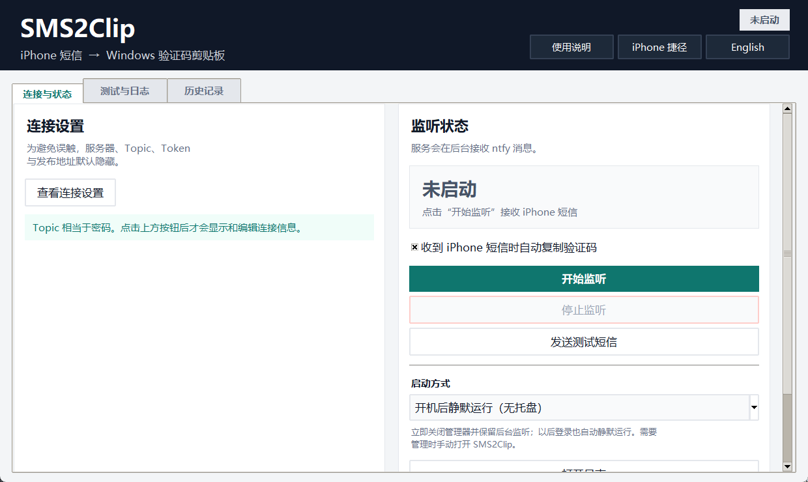
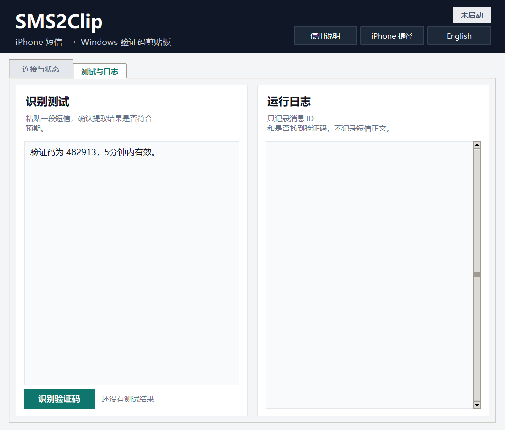
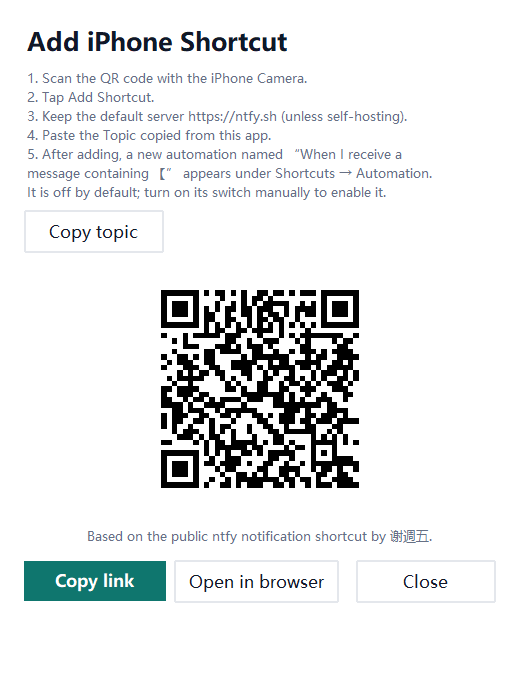
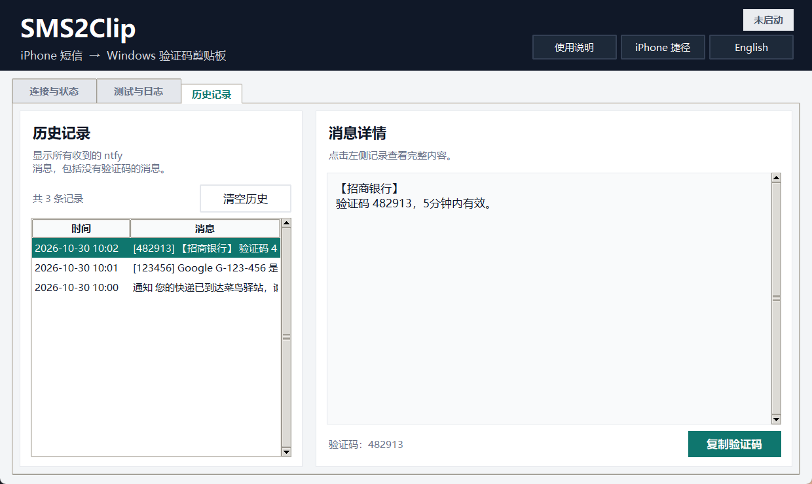

# SMS2Clip

**iPhone 短信 → ntfy → Windows 验证码剪贴板**

[English README](README.md)

> **致谢与二次开发说明：** 本项目基于 [ntfy](https://github.com/binwiederhier/ntfy) 进行二次开发，并使用在 **谢週五** 原创并公开分享的 iPhone 快捷指令基础上适配的版本。详见 [CREDITS.md](CREDITS.md)。

这是一个 Windows 桌面小工具：iPhone 通过“快捷指令”把短信转发到 ntfy，Windows 端接收后显示完整短信通知，并可按需复制验证码。默认自动复制验证码：先复制完整短信，再复制识别出的 4 位或 6 位验证码；也可以在软件里关闭自动复制。



## 主要功能

- 图形界面，不需要命令行。
- 常驻 Windows 右下角托盘。
- 托盘菜单：**打开管理**、**开始监听**、**停止监听**、**退出**。
- 关闭窗口时隐藏到托盘，监听继续运行。
- 打开 SMS2Clip 时会自动开始监听；已有监听进程时不会重复启动。
- 再次双击 EXE 会唤起已有管理窗口，不会双开。
- 支持三种启动方式：不自动启动、开机后在托盘运行、开机后静默运行。
- 连接信息默认隐藏，点击 **查看连接设置** 后才会显示，避免误触。
- 右上角支持 **中文 / English** 切换。
- ntfy 断线重连、消息去重。
- 支持公共 `ntfy.sh`、自建 ntfy、Bearer Token、Basic Auth。
- 支持全角数字、空格/短横线分隔，以及 Google 风格 `G-123456` / `G-123-456`。
- 可选择是否自动复制验证码；关闭后仍会复制完整短信。
- Windows 原生通知始终显示完整短信，并提供验证码复制按钮。
- 持久保存所有收到的 ntfy 消息，包括没有验证码的消息。
- 不会从 `1234567` 中错误截取 `123456` 或 `234567`。



## 快速添加 iPhone 捷径

可以直接使用这个公开的 iCloud 捷径：

https://www.icloud.com/shortcuts/2e72a660dec84fd9b8c7abd92d42043f

软件右上角也有 **iPhone 捷径** 按钮，会显示二维码，直接用 iPhone 相机扫描即可打开。



导入步骤：

1. 用 iPhone 相机扫描二维码，或在 Safari 中打开链接；
2. 点击 **添加快捷指令**；
3. 服务器保持 `https://ntfy.sh`（或填写你的自建服务器）；
4. topic 粘贴软件里复制的 **主题 Topic**；
5. 完成添加后，在 **快捷指令 → 自动化** 会出现一条 **我收到包含“【”的信息时** 的自动化。它默认是关闭的，需要手动打开右侧开关后才能使用；
6. 如果只想处理验证码短信，可以把自动化条件改成 `验证码` 或 `校验码`。

这个捷径会以 JSON 方式向 ntfy 发布消息，是在 **谢週五** 原创并公开分享的 ntfy 推送通知捷径基础上，为服务器/topic 配置和验证码流程二次开发的版本。详见 [CREDITS.md](CREDITS.md)。如果重复导入，会出现两条自动化，删除多余的一条即可。

## 快速开始

### 1. 获取软件

在项目目录执行：

```powershell
cd D:\CodePlayground\Python\SMS2Clip
.\build.ps1
```

生成：

```text
D:\CodePlayground\Python\SMS2Clip\SMS2Clip.exe
```

发布到 GitHub 时，可以把 `SMS2Clip.exe` 作为 Release 附件上传；仓库默认不提交这个二进制文件。

### 2. 启动软件

双击 `SMS2Clip.exe`。

首次启动会自动生成随机 topic。点击 **查看连接设置** 后，即可看到 iPhone 快捷指令需要填写的 **发布地址**。

打开 SMS2Clip 后会自动开始监听，状态变成 **正在监听**，右下角出现托盘图标；如果监听已经在运行，则直接复用，不会重复启动。

### 3. 配置 iPhone 快捷指令

1. 打开“快捷指令” → “自动化” → `+`；
2. 选择“信息”触发器；
3. 条件设置为“信息包含”“验证码”或“校验码”，并选择“立即运行”；
4. 添加“获取文本”动作，把短信转成纯文本；
5. 添加“获取 URL 内容”：
   - URL：软件里的“发布地址”
   - 方法：`POST`
   - 请求正文：`文本`，选择短信文本
   - 请求头：`Content-Type` = `text/plain; charset=utf-8`
6. 保存自动化。

软件右上角的 **使用说明** 里也内置了相同步骤。

### 4. 发送测试短信

在软件里点击 **发送测试短信**。

软件会发送：

```text
验证码为 482913，5分钟内有效。
```

几秒后：

- 当前剪贴板变成 `482913`；
- 按 `Win+V` 可以看到验证码和完整短信。

## 剪贴板行为

**收到 iPhone 短信时自动复制验证码** 默认开启。收到短信后：

1. 先复制完整短信；
2. 等待短暂间隔后，再复制验证码。

默认间隔为 `350 ms`，可以在 **高级设置** 中调整。

关闭自动复制后，只复制完整短信。Windows 通知仍会显示验证码的 **复制** 按钮，由你决定何时复制。

监听运行期间切换这个选项，软件会自动重启监听并立即应用新设置。

要保留完整短信记录，请开启：

**Windows 设置 → 系统 → 剪贴板 → 剪贴板历史记录**

如果不希望验证码同步到其他设备，请关闭剪贴板的跨设备同步。

## Windows 通知

每条收到的消息都会显示同一种通知：

- 标题：**收到短信**
- 正文：完整短信内容
- 按钮：识别到验证码时显示 **复制**

点击 **复制** 会把识别出的验证码写入剪贴板，不会替换当前完整短信通知。没有识别到验证码时，通知中不显示复制按钮。

自动复制设置会保存到 `config.json` 的 `auto_copy_code` 字段（`true` 或 `false`）。

## 历史记录

**历史记录** 标签页会保存所有收到的 ntfy 消息，不管其中有没有识别到验证码。

- 点击任意记录，可以查看完整消息；
- 识别到验证码时，可以点击下方的 **复制验证码**；
- 最多保留最近 200 条，保存在 `%APPDATA%\SMS2Clip\history.json`，重启软件后仍然存在；
- 点击 **清空历史** 可以删除全部记录。



历史消息会以明文保存在本机。如果电脑由多人共用，或者消息可能包含敏感内容，请及时清空历史。

## 验证码识别

支持：

```text
1234
123456
G-123456
G-123-456
验证码：123456
校验码：12-34
```

不会从长数字中截取：

```text
1234567     → 不识别
G-1234-567  → 不识别
```

同时会尽量排除手机号、日期、金额、快递单号、订单号等干扰。

可以单独测试：

```powershell
python -m SMS2Clip --extract "Your Google verification code is G-123-456."
```

## 托盘与启动方式

在软件的 **启动方式** 中选择：

- **不自动启动**：登录 Windows 后什么也不启动；
- **开机后在托盘运行**：登录后显示右下角托盘图标并自动开始监听；双击托盘图标可打开管理窗口；
- **开机后静默运行（无托盘）**：登录后只运行监听功能，没有管理窗口，也没有托盘图标。需要管理时，再手动打开 `SMS2Clip.exe`。

选择 **开机后静默运行（无托盘）** 后会先弹出二次确认。确认后，当前管理器会立即关闭，后台监听继续运行；如果监听尚未启动，软件会先启动监听再退出管理器。以后需要管理时，再手动打开 `SMS2Clip.exe`。

启动项保存在当前用户的 Windows `Run` 注册表中。

> **为什么不在 `services.msc` 中注册传统 Windows 服务？** 传统服务运行在 Session 0，无法访问当前登录用户的剪贴板，也不能正常弹出桌面 Toast 通知。SMS2Clip 使用当前用户会话中的无界面后台进程，因此既不会启动管理器，又能正常复制验证码和显示通知。

## 中英文切换

右上角按钮：

- 当前中文时显示 `English`，点击切换到英文；
- 当前英文时显示 `中文`，点击切换到中文。

语言会保存到 `%APPDATA%\SMS2Clip\config.json`。切换语言时，正在运行的监听也会自动重启，让通知使用新语言。

## 配置文件

打包后的 `SMS2Clip.exe` 会把设置保存到：

```text
%APPDATA%\SMS2Clip\config.json
```

`history.json`、`state.json` 和 `logs\sms2clip.log` 也保存在这个用户目录中。即使 exe 放在 `Program Files` 这种只读目录，也不影响保存。

从源码运行时，`config.json` 仍然保存在项目根目录。第一次运行打包版时，如果 exe 旁边存在旧版 `config.json`，会自动复制到 `%APPDATA%\SMS2Clip`。

修改隐藏的连接设置后，请点击 **保存连接设置**。如果监听正在运行，软件会自动重启监听并应用新的服务器或 Topic。

PowerShell 辅助脚本主要面向源码开发环境。使用 `SMS2Clip.exe` 时，请直接使用软件里的 **启动方式** 选择，它会使用 `%APPDATA%` 配置路径。

配置文件内容如下：

```json
{
  "server": "https://ntfy.sh",
  "topic": "replace-with-a-long-random-topic",
  "token": "",
  "username": "",
  "password": "",
  "since": "",
  "clipboard_gap_ms": 350,
  "state_file": "state.json",
  "log_file": "logs/sms2clip.log",
  "reconnect_min_seconds": 1,
  "reconnect_max_seconds": 60,
  "language": "zh-CN",
  "auto_copy_code": true
}
```

| 字段 | 说明 |
| --- | --- |
| `server` | `https://ntfy.sh` 或自建 ntfy 地址 |
| `topic` | iPhone 快捷指令和 Windows 端共用的随机 topic |
| `token` | 受保护 topic 的 Bearer Token |
| `username` / `password` | Basic Auth 账号密码 |
| `since` | 留空只收新消息；收到第一条后会自动使用消息 ID |
| `clipboard_gap_ms` | 完整短信与验证码的写入间隔 |
| `language` | `zh-CN` 或 `en` |
| `auto_copy_code` | 是否自动复制识别出的验证码（`true` 或 `false`） |

## 从源码运行

```powershell
python -m pip install -e .
python -m SMS2Clip.gui
```

打包：

```powershell
.\build.ps1
```

## 开发与测试

```powershell
python -m unittest discover -s tests -v
ruff check SMS2Clip tests
ruff format --check SMS2Clip tests
```

## 命令行模式

桌面版是主要入口，命令行保留用于调试和高级用法：

```powershell
python -m SMS2Clip --config .\config.json --check
python -m SMS2Clip --config .\config.json --send "验证码为 482913，5分钟内有效。" --title "SMS"
python -m SMS2Clip --config .\config.json --service
```

## 安全说明

- 公共 ntfy 的 topic 相当于密码，请使用长随机字符串。
- 短信和验证码会经过 ntfy 服务端；敏感场景建议自建 ntfy 并启用认证。
- 日志只记录消息 ID 和是否找到验证码，不记录短信正文。
- Windows 剪贴板历史可能同步到云端，如不需要请关闭跨设备同步。

## 致谢与二次开发说明

- [ntfy](https://github.com/binwiederhier/ntfy)：本项目基于 ntfy 开源的发布/订阅能力进行独立二次开发，不是 ntfy 官方客户端，与 ntfy 项目及其维护者无隶属或背书关系。
- **谢週五**：本项目使用的 iPhone 快捷指令，是在谢週五原创并公开分享的 ntfy 推送通知捷径基础上二次开发而成，并针对本项目的服务器/topic 配置与验证码使用流程进行了适配。

完整说明见 [CREDITS.md](CREDITS.md)。如署名或来源描述有误、遗漏，请提交 Issue，我们会及时更正。

## 项目结构

```text
SMS2Clip/
  entry.py          单文件 exe 入口：GUI 或后台服务
  gui.py            Tkinter 桌面界面与托盘
  i18n.py           中英文翻译
  app.py            消息 → 剪贴板业务逻辑
  clipboard.py      Windows 剪贴板写入
  extractor.py      验证码识别
  ntfy_client.py    ntfy 发布/订阅
  service.py        后台重连循环
  history.py        收到的消息历史持久化
  single_instance.py 管理器单实例保护
  state.py          最近消息 ID 持久化
  startup.py        当前用户启动方式注册表
  notifications.py  Windows 通知和操作按钮
  runtime.py        子进程和 PID 辅助
  paths.py          用户配置、状态和迁移路径
tests/              单元测试与 GUI 冒烟测试
assets/             应用图标和托盘图标
docs/               脱敏后的界面截图
build.ps1           构建单文件 exe
config.example.json 配置模板
```
